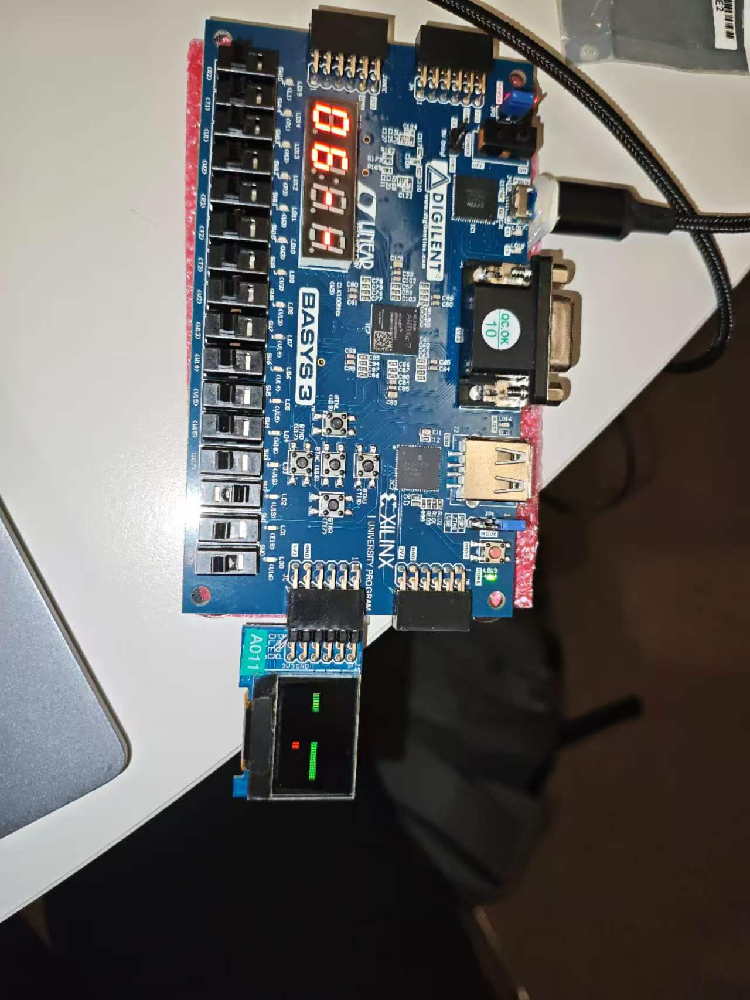
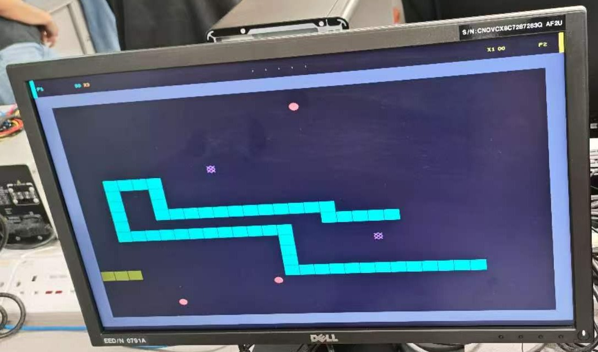
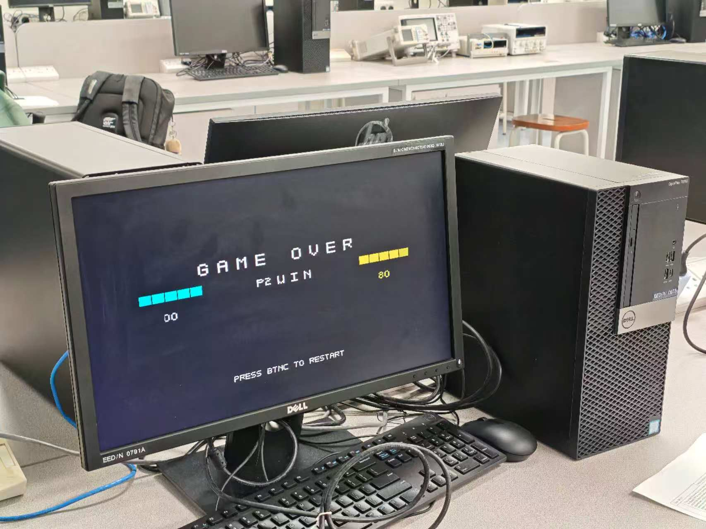
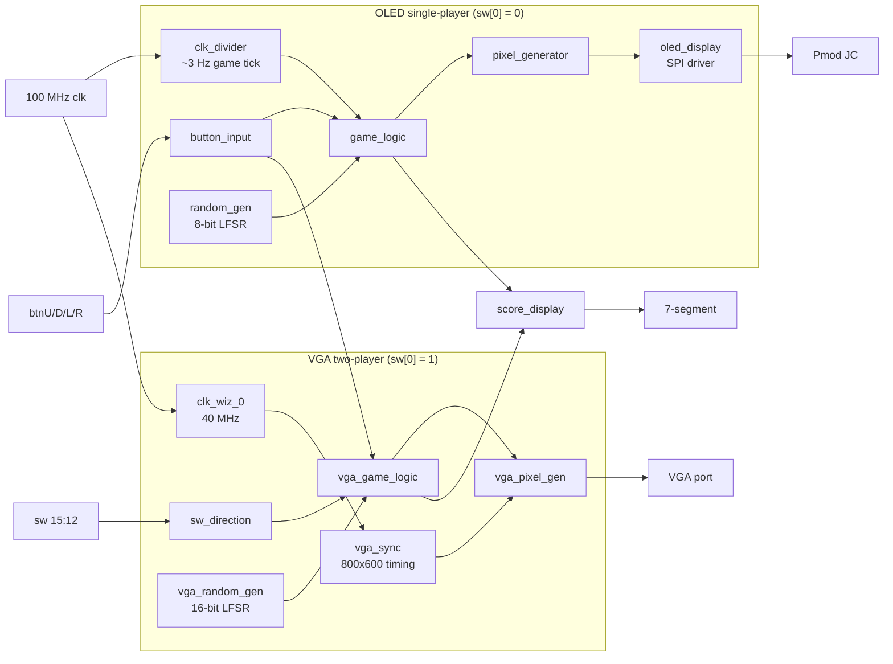

# FPGA-Based Snake Game with OLED and VGA Displays

A dual-mode Snake game implemented in Verilog HDL on the Digilent **Basys 3** (Xilinx Artix-7) FPGA. A single hardware switch selects between a **single-player game on a 96×64 Pmod OLED** and a **two-player game on an 800×600 VGA monitor**.

> **Team project:** built by a four-person team for NUS **EE2026 Digital Design**. See [My Contributions](#my-contributions) for my individual work and [Team Members](#team-members--acknowledgements) for the full split.

---

## Project Overview

The whole design is fully synchronous RTL with no soft processor. Game state, collision detection, pseudo-random food placement and pixel rendering are all implemented in hardware. The top-level module `final1` runs two independent game subsystems side by side and routes the board I/O between them:

| `sw[0]` | Mode | Display | Players |
|:---:|---|---|---|
| 0 | Single-player Snake | Pmod OLEDrgb (96×64, RGB565) on header JC | 1 (push buttons) |
| 1 | Two-player Snake | VGA, 800×600 @ 60 Hz | 2 (P1: buttons, P2: switches) |

## Features

**OLED single-player mode**
- 16×11 grid of 6×6-pixel cells. The snake grows up to 64 segments
- Wall mode (hitting the border ends the game) or wrap-around mode, selected by `sw[2]`
- Wall and self-collision detection
- Food placed pseudo-randomly by an 8-bit LFSR
- Direction input from push buttons, with 180° reversal blocked
- Score (length − 3) shown on the 7-segment display

**VGA two-player mode**
- VESA 800×600 @ 60 Hz timing from a 40 MHz pixel clock (Clocking Wizard / MMCM)
- 32×23 game grid with border walls and a HUD bar showing scores and multipliers
- Five food items on screen at once, in four types: normal, bonus (+3), speed (+2) and poison (−1). Each type is drawn with its own shape (circle, diamond, plus, X)
- Score multiplier (×1 / ×2 / ×3) that builds up while a player keeps eating non-poison food, and resets on poison
- Collision detection against the walls, a player's own body, and the other snake (including head-to-head)
- Each player dies independently. The game ends when both are dead, followed by a GAME OVER screen with the winner (or DRAW) and final scores
- Player status, multipliers and game over shown on the LEDs. Both scores shown on the 7-segment display

## Demo / Hardware Demonstration

**OLED single-player mode**

<p align="center">
  
</p>
<p align="center"><em>Basys 3 with the Pmod OLEDrgb on header JC: the snake (green) and food (red) on the OLED, and the score on the 7-segment display.</em></p>

**VGA two-player mode**

| Gameplay | Game over |
|:---:|:---:|
|  |  |
| Player 1 (cyan) and player 2 (yellow, dimmed after death), normal (circle) and poison (X) food, and the HUD with scores and multipliers | Game-over screen with the winner, both players' final scores and the restart prompt |

## Hardware & Tools

| Item | Details |
|---|---|
| FPGA board | Digilent Basys 3 (Xilinx Artix-7 `xc7a35tcpg236-1`) |
| Displays | Digilent Pmod OLEDrgb (header JC), VGA monitor (on-board VGA port) |
| Language | Verilog HDL |
| Toolchain | Xilinx Vivado 2018.2 |
| IP | Xilinx Clocking Wizard v6.0 (`clk_wiz_0`): 100 MHz → 40 MHz |

## System Architecture



**Clocking**

| Clock | Frequency | Source | Used by |
|---|---|---|---|
| `clk` | 100 MHz | Board oscillator | Inputs, LFSRs, 7-segment, top-level logic |
| `clk40` | 40 MHz | `clk_wiz_0` (MMCM) | VGA timing and pixel rendering |
| `clk6p25m` | 6.25 MHz | Counter in `final1` | OLED driver |
| Game tick | ≈ 3 Hz (100 MHz / 2²⁵) | Counter bit 24 (`clk_divider` and `final1`) | `game_logic`, `vga_game_logic` |

**Design approach**
- Snake bodies are stored as 64-entry arrays of 6-bit x/y coordinates. On each tick, every segment shifts one position down the array and the head moves in the current direction. The arrays are flattened into 384-bit buses for the renderers.
- Both renderers are combinational. For every pixel they compute the grid cell and compare it against all active snake segments and food positions, so no frame buffer (BRAM) is needed.
- Direction inputs are sampled on the 100 MHz clock and compared against the direction committed on the last game tick. This blocks 180° reversals even if several buttons are pressed within one tick.

## My Contributions

I (**Cao Jiashuo**) was responsible for the **OLED single-player game logic**:

| Module | Function |
|---|---|
| `game_logic.v` | Snake state machine: body shift and head movement, growth on eating, wall and self-collision detection, and the wall / wrap-around mode (`sw[2]`) |
| `random_gen.v` | 8-bit LFSR (taps 8, 6) mapped to valid food coordinates inside the playfield |
| `button_input.v` | Push-button direction control, with 180° reversal blocked by checking against the direction committed on the last game tick |
| `clk_divider.v` | Divides the 100 MHz clock down to the ≈ 3 Hz game tick |

The OLED renderer, the VGA two-player subsystem and the 7-segment display were developed by other team members (see below).

## RTL Module Overview

| Module (file) | Subsystem | Description | Developed by |
|---|---|---|---|
| `final1` (`final1.v`) | Top level | Mode selection, clock generation, OLED/VGA integration, LED mapping | Team |
| `game_logic` | OLED | Single-player snake movement, collision and food logic | Cao Jiashuo |
| `random_gen` | OLED | 8-bit LFSR food position generator | Cao Jiashuo |
| `button_input` | OLED / VGA P1 | Push-button direction input | Cao Jiashuo |
| `clk_divider` | OLED | Game-tick clock divider | Cao Jiashuo |
| `pixel_generator` | OLED | Pixel index → 16×11 grid mapping and colour assignment | Shen Ruwen |
| `oled_display` (`Oled_Display.v`) | OLED | Pmod OLEDrgb SPI driver (third-party, see acknowledgements) | Third-party |
| `vga_sync` | VGA | VESA 800×600 @ 60 Hz sync and pixel counters | Cao Zheran |
| `vga_pixel_gen` | VGA | Grid, food shapes, HUD font, multiplier badges, game-over screen | Cao Zheran |
| `vga_game_logic` | VGA | Two-player movement, collision, multi-food system, scoring and multiplier | Chen Jiayi |
| `vga_random_gen` | VGA | 16-bit LFSR food type generator | Chen Jiayi |
| `sw_direction` | VGA P2 | Switch-based direction input for player 2 | Chen Jiayi |
| `score_display` | Shared | Multiplexed 4-digit 7-segment score display | Chen Jiayi |
| `clk_wiz_0` (`ip/clk_wiz_0.xci`) | VGA | Xilinx Clocking Wizard, 100 → 40 MHz | Xilinx IP |

## Controls & I/O

| Board I/O | Function |
|---|---|
| `sw[0]` | Mode select: 0 = OLED single-player, 1 = VGA two-player |
| `sw[2]` | OLED mode: 0 = wall kills, 1 = wrap-around |
| `btnU` / `btnD` / `btnL` / `btnR` | OLED player / VGA player 1 direction |
| `sw[15]` / `sw[14]` / `sw[13]` / `sw[12]` | VGA player 2 direction: up / down / left / right |
| `btnC` | Reset / restart |
| 7-segment | OLED: score on left two digits, `--` on right. VGA: P1 score (left), P2 score (right) |
| `led[9]` | Game over |
| `led[8]` / `led[7]` | VGA: player 2 / player 1 dead |
| `led[5:4]` / `led[3:2]` | VGA: player 1 / player 2 score multiplier |
| Pmod JC | Pmod OLEDrgb |
| VGA port | 800×600 @ 60 Hz output |

## Build Instructions

**Requirements:** Vivado (developed with 2018.2), Basys 3 board, Pmod OLEDrgb and/or a VGA monitor.

```bash
git clone https://github.com/galaxyostrich/fpga-snake-game.git
cd fpga-snake-game

# Recreate the Vivado project in build/
vivado -mode batch -source scripts/create_project.tcl

# Or recreate the project and run synthesis, implementation and bitstream generation
vivado -mode batch -source scripts/create_project.tcl -tclargs build
```

Then open `build/fpga_snake_game/fpga_snake_game.xpr` in Vivado, or program the board directly:

1. Connect the Pmod OLEDrgb to header **JC** and/or a monitor to the VGA port.
2. In Vivado, open **Hardware Manager → Open Target → Auto Connect**.
3. Select **Program Device** and choose `build/fpga_snake_game/fpga_snake_game.runs/impl_1/final1.bit`.
4. Use `sw[0]` to select the mode and press `btnC` to start a new game.

> On Vivado versions newer than 2018.2, the script upgrades the Clocking Wizard IP automatically. The reconstruction script has been statically reviewed but **has not yet been run end-to-end**. Please open an issue if it fails on your Vivado version.

## Implementation Results

These figures come from the post-placement and post-route reports of the original Vivado 2018.2 project (default strategies):

| Resource | Used | Available | Utilization |
|---|---:|---:|---:|
| Slice LUTs | 7,081 | 20,800 | 34.0% |
| Slice registers (FF + latch) | 2,817 | 41,600 | 6.8% |
| Block RAM | 0 | 50 | 0% |
| DSP48 | 0 | 90 | 0% |
| MMCM | 1 | 5 | 20% |
| Bonded IOB | 56 | 106 | 52.8% |

The design uses no BRAM or DSP resources. Snake state is held in registers, and both renderers are purely combinational.

**Timing:** The post-route timing summary reports WNS = +6.328 ns with no failing endpoints. This only covers the **245 endpoints on constrained clocks**. The game-tick and 6.25 MHz OLED clocks are generated by fabric counters and have no clock constraints, so paths in those domains are not timing-analysed (see [Known Limitations](#known-limitations)). This is **not** a full timing sign-off.

## Testing & Verification

- The design was synthesized, implemented and converted to a bitstream in Vivado 2018.2.
- Functionality was checked by interactive testing on the Basys 3 board.
- **No simulation testbenches are included in this repository**, and no simulation or coverage results are claimed. Adding self-checking testbenches (e.g. for `game_logic` and `button_input`) is a planned improvement.

## Known Limitations

These limitations are recorded as-is. The RTL in this repository is the submitted course design and has not been modified.

- **Unconstrained derived clocks:** The game tick and the OLED clock are generated by fabric counters rather than clock-enable logic or an MMCM output. Vivado reports these registers as non-clocked (methodology check TIMING-17).
- **Inferred latches:** Some registers use a non-constant value on asynchronous reset (e.g. the LFSR seed and the initial food position), so synthesis infers 24 latches.
- **Fixed OLED LFSR seed:** `random_gen` XORs its seed with a `free_counter` register that is never driven, so the seed is effectively constant. The LFSR free-runs at 100 MHz and is sampled on the game tick when food is eaten, so food positions depend on when the player eats, not on a hardware entropy source.
- **Food placement:** New food is not checked against snake positions, so it can spawn on a snake's body.
- **OLED collision timing:** Wall and self-collision checks in `game_logic` use the head position before the move is applied, so a collision is registered one game tick after it occurs.
- **"Speed" food:** In the VGA mode, the speed food awards +2 points but does not change game speed.
- **Fixed game speed:** Both modes run at a fixed tick of ≈ 3 Hz.
- **Toolchain version:** The project targets Vivado 2018.2. Newer versions require an IP upgrade of `clk_wiz_0`.
- **No automated verification:** See [Testing & Verification](#testing--verification).

## Team Members & Acknowledgements

NUS EE2026 Digital Design, Team S6_11:

| Member | Responsibility |
|---|---|
| **Cao Jiashuo** | OLED single-player game logic (movement, collision, LFSR food, button input) |
| Shen Ruwen | OLED pixel renderer |
| Cao Zheran | VGA display system (timing generator, pixel renderer, HUD) |
| Chen Jiayi | VGA two-player game logic, food and scoring system, player I/O, score display |

**Third-party code**
- `rtl/Oled_Display.v` is a Pmod OLEDrgb driver that was not written by the team. It is adapted from [jhol/otl-icoboard-pmodoledrgb-demo](https://github.com/jhol/otl-icoboard-pmodoledrgb-demo) and is © 2017 Joel Holdsworth under the BSD license reproduced in the file header.
- `ip/clk_wiz_0.xci` is a Xilinx Clocking Wizard IP configuration.

**References used by the team**
- [spencer-tb/snake-game-fpga](https://github.com/spencer-tb/snake-game-fpga)
- [Derek-X-Wang/VGA-Text-Generator](https://github.com/Derek-X-Wang/VGA-Text-Generator)

## Repository Structure

```
fpga-snake-game/
├── rtl/                     Verilog source files (13 modules)
├── ip/clk_wiz_0.xci         Clocking Wizard IP configuration
├── constraints/basys3.xdc   Basys 3 pin and clock constraints
├── scripts/create_project.tcl   Vivado project reconstruction script
└── docs/images/             Hardware demonstration photos
```

## License

No license has been selected yet. All rights are reserved by the respective authors. Third-party files keep their original license terms.
